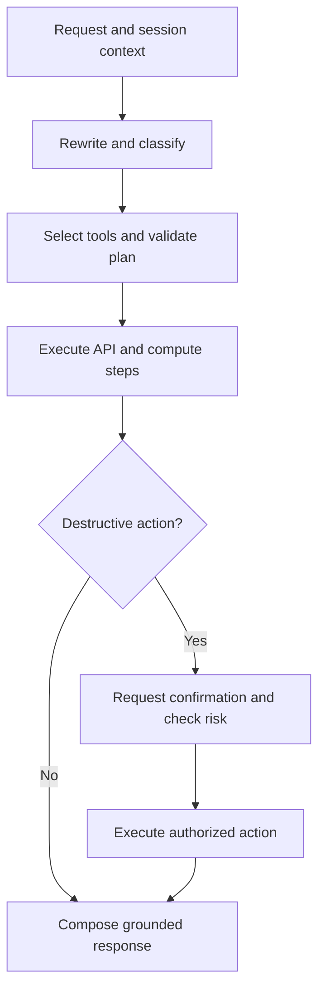

# Dionisio Agent

### AI Agent Engineering Case Study

An LLM-powered CRM assistant for restaurant operations, built in Python with validated execution plans, deterministic data processing, and explicit confirmation for destructive actions.


**[Architecture](agent/ARCHITECTURE.md) · [Demo walkthrough](agent/DEMO.md) · [Developer setup](agent/README.md)**

## The problem

Restaurant teams work across customer records, reservations, orders, and coupons. Even a simple request can require several API calls, filtering, and a decision about whether changing a record is appropriate.

This engineering case study explores how a natural-language assistant can coordinate those operations while keeping data transformations explicit, actions reviewable, and incomplete answers visible.

## What the agent does

| Capability | Implementation |
| --- | --- |
| Interpret conversational requests | Rewrites follow-up requests using session context and identifies relevant CRM domains. |
| Plan multi-step work | Produces a typed JSON plan with API, compute, verification, and fan-out nodes. |
| Process returned data | Runs filtering, counting, sorting, and lookup operations in Python. |
| Control destructive actions | Requests confirmation and checks action risk before execution. |
| Handle uncertainty | Stops for clarification when a sensitive lookup returns multiple candidates; reports unsupported operations and partial execution. |
| Inspect execution cost | Records request latency, token usage, caching information, and cost through OpenRouter telemetry. |

Example request, in the application's current Portuguese interface:

> Lista os clientes que gastaram mais de R$500 no último mês e nunca usaram cupom.

The agent selects the relevant customer tools, retrieves records, and applies explicit filtering and counting operations before writing the response.

## Architecture



The diagram summarizes the request flow. The executor checks risk at the individual tool-call level; confirmation can pause execution across conversational turns.

**Key engineering decisions**

- **Validate plans before execution.** Pydantic checks the structure of the model's proposed plan. Invalid JSON receives one repair attempt.
- **Compute with code.** Python performs data operations; the response model describes the computed results.
- **Read and verify before acting where dependencies allow.** The executor separates sensing and action stages, with explicit handling of partial effects.
- **Avoid automatic write retries.** The API does not supply idempotency keys, so retrying a mutation could repeat an action.
- **Bound recovery and concurrency.** Replanning is limited, and fan-out supports bounded parallel reads.
- **Keep orchestration explicit.** The project uses custom Python orchestration rather than an agent framework, making control flow available for inspection and testing.

See [architecture and trade-offs](agent/ARCHITECTURE.md) for the detailed design.

## Validation and observability

The project's existing documentation records a benchmark run with **31 scenarios and 127/127 checks**, covering read operations checked against API-derived expectations, confirmation flows, edge cases, and multi-turn interactions. [Original benchmark documentation](https://github.com/GabrielNegreiro28/dionisio-agent/blob/cc097642cca5891609eac3a7fa1d763d202bc65a/agent/ARCHITECTURE.md).

The repository includes:

- A [benchmark runner](agent/benchtest.py) that generates a local `benchtest_report.md` with validation and cost/latency telemetry.
- Tests for OpenAPI/catalog consistency, deterministic data operations, and planning rules.
- A CLI debug mode for inspecting plans and execution.
- A probe utility for inspecting the available API tools and data.

Reproducing the live benchmark requires valid credentials and access to the external CRM test service. Use the generated report to assess results in your environment.

## Quick start

**Requirements:** Python 3.10+, an OpenRouter API key, and credentials for the external Dionisio CRM test API. The assistant's current prompts and conversational examples are in Portuguese; this documentation is in English.

From the repository root, in PowerShell:

```powershell
Set-Location .\agent
py -3 -m venv .venv
.\.venv\Scripts\python.exe -m pip install -r requirements.txt
if (-not (Test-Path .env)) { Copy-Item .env.example .env }
notepad .env
```

Set `DIONISIO_API_KEY` and `OPENROUTER_API_KEY`. Set `LLM_MODEL` and, optionally, `LLM_MODEL_FAST` to model IDs supported by your OpenRouter account. Review the existing defaults before running.

```powershell
.\.venv\Scripts\python.exe main.py --debug
```

Enter `sair` to exit. The explicit Python path lets you run the project without activating the virtual environment.

### Run checks

From `agent/`, after configuring credentials:

```powershell
# Benchmark: read-only scenarios by default.
.\.venv\Scripts\python.exe benchtest.py

# Focused tests.
.\.venv\Scripts\python.exe -m pip install pytest
.\.venv\Scripts\python.exe -m pytest tools/test_openapi_sync.py execution/test_data_ops.py planning/test_plan_rules.py -q
```

The optional `--mutating` benchmark exercises destructive flows against the configured service. Run it only with disposable test data. See the [demo walkthrough](agent/DEMO.md) for the confirmation interaction.

## Repository map

```text
agent/
  clients/       API and LLM clients; telemetry
  execution/     Plan execution and deterministic data operations
  knowledge/     Product documentation and ingestion
  planning/      Typed plans and planning rules
  retrieval/     Knowledge retrieval components
  safety/        Action risk and confirmation controls
  tools/         Tool catalog and OpenAPI consistency checks
  main.py        Interactive CLI
  benchtest.py   Scenario benchmark runner
  probe.py       API inspection utility
  README.md      Developer setup
  ARCHITECTURE.md
  DEMO.md
DESIGN.pdf       Original design document
```

## Scope and limitations

- This is an engineering study using an external test API; it is not a deployed restaurant product.
- Session memory is in-process and does not persist between runs.
- Tool availability limits supported actions, including menu changes and outbound notifications.
- Confirmation and disambiguation controls cover implemented paths; they are not a general guarantee for every possible action chain.
- Multi-step writes can leave partial effects. The agent reports performed actions and can suggest compensation; it does not provide transactional rollback.
- The static tool catalog needs consistency checks as the API evolves.

These boundaries define the next engineering work: persistent state, broader action validation, integration coverage, and more robust write semantics.

## Author

**Gabriel Negreiro Oliveira**

[LinkedIn](https://www.linkedin.com/in/gabriel-negreiro-oliveira/) · [GitHub](https://github.com/GabrielNegreiro28) · [Email](mailto:gabrielnegreiro13@gmail.com)
